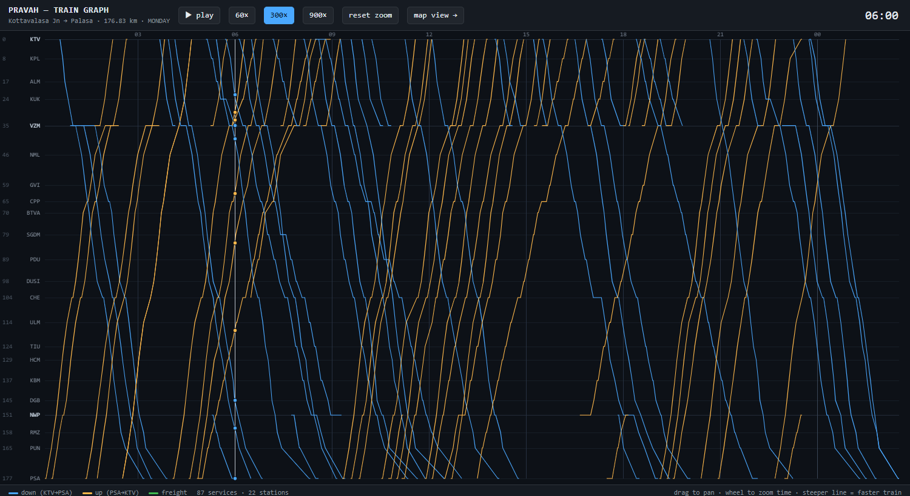
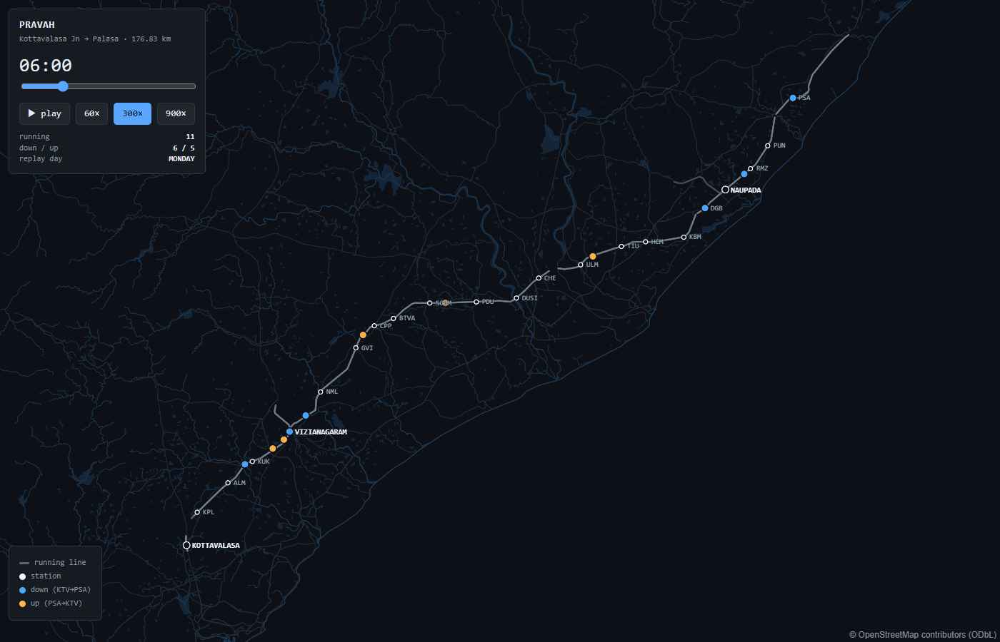

# PRAVAH

**Precision Rail Allocation for Vacant Headways** — a decision support system for
maximising freight throughput on a railway section.

Study corridor: **Kottavalasa Junction (KTV) → Palasa (PSA)**, 176.83 km, 22 stations,
Waltair Division, East Coast Railway — on the Howrah–Chennai trunk route.

## The problem, measured

Freight performance on this corridor, computed from 95,219 real block-section-level
goods movement records covering 1–27 August 2025:

| | |
|---|---|
| Freight trains cleared per day (end to end) | **31.2** |
| Median corridor transit time | **10.52 h** |
| Effective end-to-end speed | **16.8 km/h** |
| Median running speed *while in motion* | 30.8 km/h |
| **Share of transit time spent standing still** | **~45%** |

Throughput here is limited not by the track, but by how the track is used. Reproduce
these figures with `python analysis/baseline.py`.

## Repository layout

```
analysis/
  baseline.py            historical throughput baseline from goods movement records
  scenario_demo.py       worked example: greedy dispatch vs look-ahead planning
  check_osm_coverage.py  verifies OpenStreetMap coverage of the corridor
  build_corridor.py      extracts track geometry from cached OSM data
  build_linref.py        merges it into one chainage-addressable reference line
  build_basemap.py       fetches offline basemap context layers
  build_replay.py        turns the timetable into a chainage-over-time feed
pravah/
  section.py             operational model: blocks, lines, capacities, timings
  corridor.py            linear referencing: chainage -> geographic position
web/
  index.html             offline corridor viewer (MapLibre)
  vendor/                MapLibre GL, vendored so nothing loads from a CDN
  data/replay.json       one day of train movements
data/
  ktv-psa/               official ICMS infrastructure and schedule extracts
  osm/                   derived corridor geometry and basemap (see Licensing)
docs/
  make_synopsis.py       generates the project synopsis
  PRAVAH_Synopsis.docx   generated output
```

## The views

### Train graph — `/web/graph.html`



The time–distance diagram a controller actually plans on. Stations down the
left at **true chainage scale**, time across the top, one line per service.
Down trains descend, up trains climb, and the slope of a line *is* its speed,
so a conflict is two lines meeting. Station dwells show as short horizontal
runs. Drag to pan, wheel to zoom the time axis, hover for detail, click to
isolate a path, double-click to move the clock.

This is where precedence and crossings will be read once the optimiser lands:
freight paths threading the gaps, with conflicts marked.

### Corridor map — `/web/`



A map of the section with the day's trains moving along it, driven by the real
timetable. It runs **entirely offline** — no tile server, no API key, no CDN.

```bash
uvicorn pravah.api:app --port 8000     # then open http://localhost:8000/
```

The clock lives on the **server**, not in the browser, so every connected
client sees the same instant and control is shared — pause on one screen and
every screen pauses. That is what a control room needs, and it is where the
optimiser will later write its plan.

If no service is running the page falls back to replaying `web/data/replay.json`
with a local clock, so the viewer still works behind a plain static server:

```bash
python -m http.server 8000      # fallback; open http://localhost:8000/web/
```

The HUD shows which mode is active.

Geographic context rather than an operating view. Play, scrub, or change
replay speed; click a train for its type, chainage, speed and current block.

Both views run off the **same server clock**, so two windows side by side stay
in step automatically — pause in one and the other pauses too. Train positions come from `pravah/corridor.py`'s
linear referencing, reimplemented identically in the browser — both produce the
same coordinates to five decimal places.

The basemap is purpose-built rather than general-purpose: settlements, water,
rivers, coastline and major roads for this corridor only, about 4.9 MB of
GeoJSON that MapLibre renders directly. A full tile basemap would be far larger
and would need a server.

### Service endpoints

| | |
|---|---|
| `GET /api/health` | service and data status |
| `GET /api/corridor` | stations, polyline, chainage mapping |
| `GET /api/state?t=` | train states at one instant (polling fallback) |
| `WS /ws/live` | pushed state at 4 Hz, plus `play` / `pause` / `seek` / `speed` |

State is shaped the way a live feed would be, so a real COA or FOIS source can
replace `ReplaySource` without the clock, the socket or the viewer changing:

```json
{"t": 21600, "trains": [{"id":"12841","type":"SUF","dir":"UP",
                         "km":43.2,"speed":61.0,"status":"running"}]}
```

Check it with `python analysis/test_live_feed.py` (service must be running).

To rebuild everything from the cached OSM responses:

```bash
python analysis/build_corridor.py   # track geometry
python analysis/build_linref.py     # chainage reference line
python analysis/build_basemap.py    # offline context layers
python analysis/build_replay.py     # one day of movements
```

## Running

```bash
pip install -r requirements.txt

python analysis/baseline.py         # measured throughput baseline
python analysis/scenario_demo.py    # greedy vs planned dispatch, real Monday data
python analysis/build_corridor.py   # rebuild map geometry (offline, from cache)
python docs/make_synopsis.py        # regenerate the synopsis
```

## The section graph

The operational model the optimiser and the verification simulator both
consume — distinct from `corridor.py`, which answers the geographic question
of where a chainage sits on a map.

```
21 links, 46 running lines   DN / UP / MID, with signalling and line speed
103 station lines            48 loops, 70 platforms, individual lengths
19 of 22 stations            have precedence/crossing facility
80 holding opportunities     for a 650 m rake; none at the four halts
```

A link between adjacent stations appears twice in the extract, once per
direction, but is **one physical link carrying shared lines**. Modelling the
*line* as the resource is what makes single-line working expressible: close
the down line and down trains must share the up line with opposing traffic,
which is exactly when crossings have to be decided.

```bash
python -m pravah.section                  # summary
python -m pravah.section --schematic      # corridor strip: lines, holding, signalling
python -m pravah.section --full           # every station line and link timing
python analysis/check_section_graph.py    # 18 checks against the real timetable
```

Class speeds are derived from the published schedule (90th percentile of
observed point-to-point speeds, capped at line speed) rather than assumed.
Freight uses the measured 31 km/h median from the goods movement log, to be
replaced per block by the learned estimator.

## Verification

Nothing the optimiser produces is believed until something else has checked
it. `pravah/verify.py` re-derives every occupation from the plan's times alone
and reports what breaks — block conflicts, headway, crossings under
single-line working, continuity, blocking discipline, closures, running times,
holding feasibility, station capacity and service integrity — plus the KPIs
the problem statement names.

It imports nothing outside the standard library except `pravah.section`, so
the independence from the solver is visible by reading it. That shared
dependency is the honest limit: a wrong headway in the section graph would be
inherited by both, which is why the section graph is validated separately.

```bash
pytest tests/test_verify.py -q        # 23 checks, mostly deliberately broken plans
python analysis/check_verifier.py     # verify the real Monday timetable
```

Every threshold lives in [config/verifier.toml](config/verifier.toml) —
service tolerance (0 by default, raise it for the throughput-versus-
punctuality curve), headway margin, running-time slack, holding rules, and the
severity of each individual check.

### What the ground-truth test found

Running the verifier against the 87 services Indian Railways actually ran
started at **225 errors and ended at 7 (0.63% of 1,103 occupations)**. The
difference was almost entirely the verifier and the test harness being wrong,
which is the point of the exercise:

- Putting every down train on one line manufactured 103 conflicts the railway
  never had. The timetable records *when* a train ran, never *which line* it
  used, so a line has to be assigned.
- A percentage-only running-time tolerance cannot absorb minute-rounding in a
  published schedule — 2% of a four-minute block is five seconds. 113 of the
  errors had a median shortfall of 0.42 min. An absolute floor was added.
- **A commercial stop is not a precedence hold.** Routhpuram has no crossing
  facility but trains stop there daily. Stopping for passengers needs a
  platform; being held so another train may pass needs a loop. Conflating
  them produced 14 false violations, and the distinction now lives in
  `Hold.purpose`.

The 7 that remain are a genuine calibration finding: the KUK–VZM permanent
speed restriction records a 337-second penalty, so the model budgets 10.7
minutes where the railway schedules 9.0. The recorded penalty looks
worst-case. Worth confirming before the optimiser plans conservatively there.

## Data

**ICMS extracts** (`data/ktv-psa/`) — 63 block sections, 22 stations, 103 station
lines with individual loop lengths, 231 scheduled services across 3,901 timing
records, 9 permanent speed restrictions, and 95,219 goods movements of which 15,449
fall on this corridor.

Three parsing traps, all handled in the loaders:

- `BLOCKSCTN` and `BLOCKSCTNLINE` contain a **repeated header row mid-file**, and are
  **duplicated exports** — 125 rows for 63 distinct block sections.
- `SCHEDULE` times are **seconds since midnight of day 1 of the journey**, not of the
  day. Time of day is `ARRIVAL % 86400`; journey day is `ARRIVAL // 86400 + 1`.
- `Block Hrs` in the goods log is a **day fraction, not hours** — multiply by 24.

**Corridor geometry** (`data/osm/`) — derived from OpenStreetMap. All 22 stations
match on `railway:ref` (the official IR station code). The extracted centreline
measures 178.99 km against the official 176.83 km, a 1.2% difference.

Three stations (BTVA, SGDM, NWP) sit at the wrong place along the OSM line; BTVA
is out by 2.1 km. The geometry either side of them is correct — CPP→BTVA→SGDM
measures 13.24 km against an official 13.27 km — so `build_linref.py` keeps the
well-matched stations as control points and re-places the others at the position
their official chainage implies. Worst inter-station error afterwards is 5.5%.

Cached Overpass responses live in `data/osm/_cache/` and are committed
deliberately: the public endpoints fail often, and the cache is what makes the
pipeline reproducible offline.

**Timetable quirk** worth knowing: UP services are stored along the KTV→PSA route
axis exactly like DN ones, but with their times counting *backwards*, because the
train physically runs PSA→KTV. They must be reversed at stop level — reversing a
flattened point list also swaps arrival before departure at each stop.

## Licensing

Corridor geometry under `data/osm/` is derived from OpenStreetMap and is licensed
**ODbL**. Any map rendered from it must display *"© OpenStreetMap contributors"*.

The ICMS extracts under `data/ktv-psa/` are Indian Railways operational records for
the Kottavalasa–Palasa section; confirm redistribution terms before publishing.
