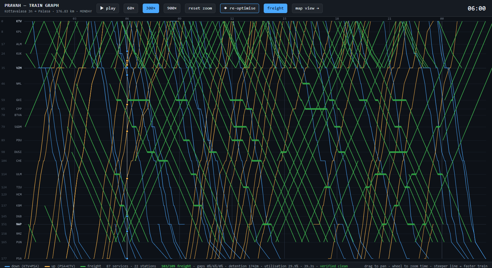
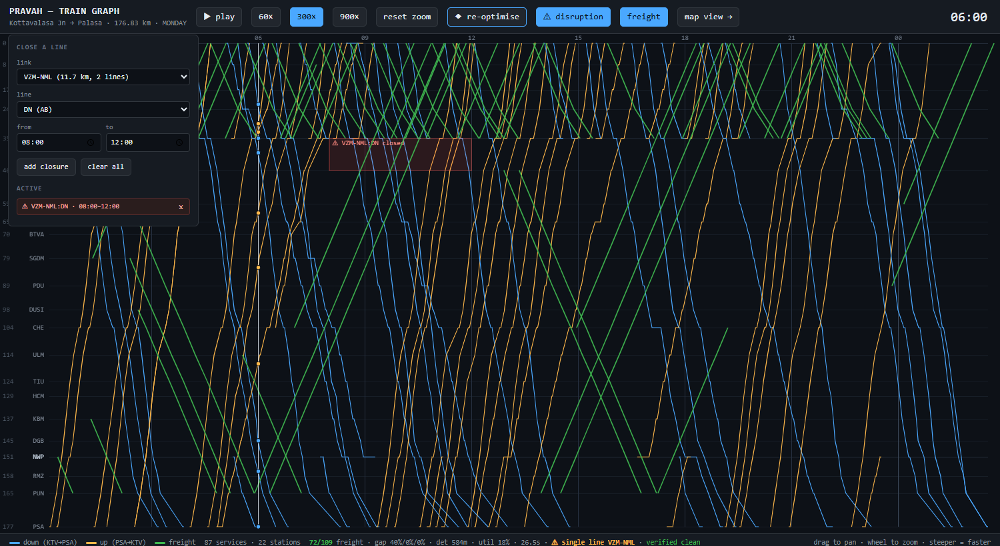
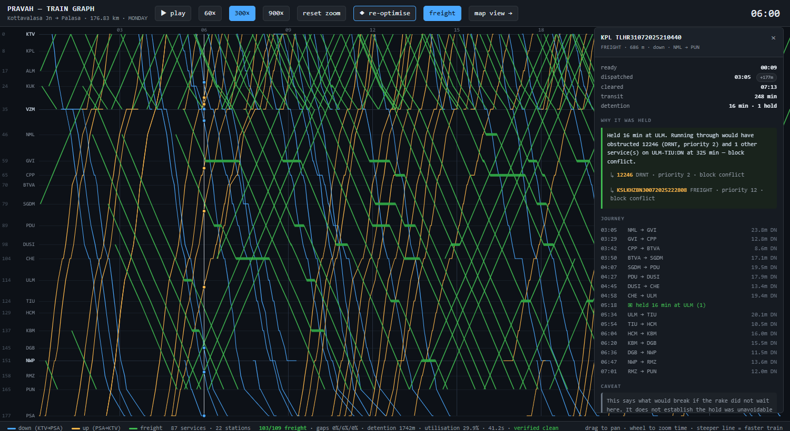

# PRAVAH

**Precision Rail Allocation for Vacant Headways** — a decision support system for
maximising freight throughput on a railway section.

Study corridor: **Kottavalasa Junction (KTV) → Palasa (PSA)**, 176.83 km, 22 stations,
Waltair Division, East Coast Railway — on the Howrah–Chennai trunk route.

## The problem, measured

Freight performance on this corridor, computed from 95,219 real block-section-level
goods movement records covering 1–27 August 2025:

| | |
|---|---|
| Freight trains cleared per day (end to end) | **31.2** |
| Median corridor transit time | **10.52 h** |
| Effective end-to-end speed | **16.8 km/h** |
| Median running speed *while in motion* | 30.8 km/h |
| **Share of transit time spent standing still** | **~45%** |

Throughput here is limited not by the track, but by how the track is used. Reproduce
these figures with `python analysis/baseline.py`.

## Repository layout

```
pravah/                  the system
  section.py             operational model: blocks, lines, capacities, timings
  demand.py              the rakes awaiting dispatch
  timetable.py           scheduled services as fixed obstacles
  optimise.py            CP-SAT freight path optimisation
  greedy.py              the baseline: dispatch as soon as the road is clear
  verify.py              independent checking, and the KPIs
  plan.py                the contract between optimiser and verifier
  corridor.py            linear referencing: chainage -> geographic position
  replay.py              simulation clock and train-state source
  api.py                 service: REST, websocket feed, optimise endpoint
analysis/                one-shot builders and validators
  baseline.py            measured throughput baseline from the goods log
  build_freight_demand.py  inverts recorded movements into demand
  build_observed_freight.py  recorded freight paths, for the baseline overlay
  compare_baseline.py    greedy dispatch against CP-SAT on identical inputs
  build_corridor.py      track geometry from cached OSM data
  build_linref.py        one chainage-addressable reference line
  build_basemap.py       offline basemap context layers
  build_replay.py        the timetable as a chainage-over-time feed
  calibrate_running_times.py  modelled times against the schedule
  check_section_graph.py verifies the section model
  check_verifier.py      verifies the verifier, against the real timetable
  evaluate.py            optimised plans against recorded operations
  scenario_demo.py       worked example: greedy vs look-ahead dispatch
tests/                   pytest; mostly deliberately broken plans
web/
  index.html             corridor map
  graph.html             train graph, with the optimiser's output on it
  vendor/                MapLibre GL, vendored so nothing loads from a CDN
config/verifier.toml     every verification threshold
data/
  ktv-psa/               official ICMS infrastructure and schedule extracts
  osm/                   derived corridor geometry and basemap
  derived/               demand, calibration, evaluation
docs/
  make_synopsis.py       generates the project synopsis
```

## The views

### Train graph — `/web/graph.html`


The time–distance diagram a controller actually plans on. Stations down the
left at **true chainage scale**, time across the top, one line per service.
Down trains descend, up trains climb, and the slope of a line *is* its speed,
so a conflict is two lines meeting. Station dwells show as short horizontal
runs. Drag to pan, wheel to zoom the time axis, hover for detail, click to
isolate a path, double-click to move the clock.



Press **optimise freight** and the optimiser plans the visible window: freight
paths appear in green threading the gaps between the fixed services, holds show
as thick horizontal runs where a rake is stood aside, and anything the verifier
objects to is marked. The strip along the bottom reports what it cost —
dispatched against offered, the optimality gap at each lexicographic stage,
detention, line utilisation, and whether the plan verified clean.

The freight slopes are shallower than the passenger ones because they are:
roughly 31 km/h against 60–125.

### The plan against the record

Press **recorded** and the freight that actually ran that day is drawn over
the same axes in dashed violet, at the same scale, with nothing rescaled
between them. The planned paths are the steep green ones; the recorded paths
are the ones with long flat stretches in them.

```bash
python analysis/build_observed_freight.py
```

The demand extract keeps only where each consignment joined the corridor and
where it left. This recovers the part it discards — every intermediate
arrival and departure — and emits it as chainage over time, the same shape as
the replay feed. A station where departure is later than arrival becomes a
flat run on the chart, so standing time is visible rather than averaged into
a statistic.

```
rakes with a path      : 2460 over 27 days
  dropped: {'inconsistent times': 119, 'single station': 608,
            'implausible transit': 23}

busiest day            : 2025-08-01  108 rakes, 26 end to end
  median transit       : 268 min
  median standing      : 86 min
  standing share       : 47% of transit
```

That 47% is computed from the per-station records and arrives independently
at roughly the 45% the throughput baseline measures a different way, which is
a useful check on both.

**119 consignments are dropped rather than repaired.** Their records have a
rake leaving one station after it had already reached the next, and there is
no way to tell which of the two timestamps is wrong. A path reconstructed
over that contradiction would then be compared against the plan as though it
were evidence, so it is left out and counted instead.

Transit here is measured **arrival to arrival**, matching the demand
extract's `observed_transit_min`, and standing time counts dwells up to the
last arrival — a rake has cleared the section once it reaches its exit
station, and what it does in the yard afterwards is not this section's
business. `tests/test_observed.py` holds both invariants; both were written
after the first version of this builder got them wrong.

### What look-ahead actually buys

Comparing a plan against the recorded day cannot isolate the scheduler's
contribution, because the record contains yard work, crew changes and waiting
for a path through the *next* section — none of which any scheduler here
could remove. So there is a second baseline that can: `pravah/greedy.py`
dispatches the same rakes first-come-first-served, sending each as soon as
the road ahead is clear and never holding one back for a train that has not
yet arrived.

It shares the section graph, the running times, the signalling rules, the
routing and the verifier with the optimiser. **Only the decision rule
differs**, so every minute of difference is attributable to look-ahead. A
greedy plan verifies just as clean as an optimised one — it loses on quality,
never on legality, which is what makes it a fair baseline rather than a
strawman.

```bash
python analysis/compare_baseline.py --limit 60 --closure VZM-NML:DN:480:720
```

On the busiest day, planning the full 24 hours. Every figure below comes from
that one command, recorded in `data/derived/baseline_comparison.json`:

| | greedy | CP-SAT | difference |
|---|---|---|---|
| dispatched | 99/112 | 100/112 | **+1** |
| total detention, paired | 2496 min | 1498 min | **−40%** |
| total transit, paired | 17678 min | 16681 min | −5.6% |
| rakes running faster | — | 42 | |
| rakes running slower | — | 9 | |
| CP-SAT stage-1 gap | n/a | **0%** | |
| solve time | 0.02 s | 122 s | |

Totals are **paired** over the 99 rakes both schedulers dispatched. Comparing
sums across different rake sets would reward whichever scheduler ran more
trains, which is the thing being measured.

**Throughput is not the headline on a clean day — detention is.** The two
dispatch nearly the same number of rakes because the section has room: the
busiest line runs near a third occupied, so there is slack for a poor plan to
succeed in. What look-ahead buys is that the same trains run while stopping
40% less. Stage 1 closes to 0%, so the 100 is a proven maximum, and the +1
is all there is to win on throughput that day.

### The same comparison under disruption

Close `VZM-NML:DN` for the morning and the picture inverts:

| | greedy | CP-SAT |
|---|---|---|
| dispatched | 84/112 | **87/112** |
| total detention, paired (80 rakes) | 1869 min | 2687 min |
| total transit, paired | 11157 min | 11975 min |
| CP-SAT stage-1 gap | n/a | **8.0%** |

CP-SAT clears three more rakes, and the rakes they both run take **7% longer**
under CP-SAT. That is not a defect. The objective is lexicographic, so
throughput is bought first and transit is minimised only within whatever
throughput allows; squeezing extra rakes through a single line costs everyone
else waiting, and the optimiser is instructed to pay that price. If that is
the wrong trade for a real controller, it is the objective that should
change, not the solver.

**The stage-1 gap matters more than either number.** At 8% it never proved
even the throughput figure — and it stays at roughly 8% when given 200 s per
stage instead of 60, so this is not a budget that one more minute fixes.
Under disruption the honest claim is *"at least 87"*, not *"the most
possible"*. Stage 2 does not report at all under closure: the transit
objective runs out of time before producing a bound.

### Disruption, and where crossings come from



The corridor is double or triple track throughout, so two trains can always
pass and a **crossing can never arise** — which is awkward, because the
problem statement asks for precedence *and* crossings. Withdraw a line and it
does: both directions are left sharing what remains, and opposing movements
have to be crossed at a station.

Press **disruption**, pick a link, a line and a window, and re-optimise. The
closure is shaded on the chart, the strip reports which links have been
reduced to single-line working, and the cost shows up immediately — closing
VZM–NML:DN for four hours takes dispatch from 103 rakes to 72.

A closure applies to scheduled services too: a line withdrawn for an
engineering block does not carry passenger trains either. Where that leaves
two opposing services on one line, the conflict is reported against the
baseline rather than blamed on the freight plan — the passenger timetable is
fixed, so the optimiser cannot resolve it and does not pretend to.

### Why a rake was held



Click any planned freight path and the panel says what the plan did to it and
why — when it was ready, when it was dispatched and how long it waited, then
every hold with the reason behind it:

> **Held 16 min at Urlam.** Running through would have obstructed **12246**
> (Duronto, priority 2) and 1 other service on ULM–TIU:DN at 05:25 —
> block conflict.

Hovering a named service highlights its path on the chart, so the conflict is
visible rather than asserted.

**No separate reasoning engine was needed.** A hold exists precisely because
running through would break something, so the explanation is the
counterfactual: remove the hold, pull the later legs earlier, and re-verify.
Whatever the verifier reports *is* the reason — already worded, already naming
the train and the rule. It costs one verification sweep per hold, about 0.14 s
for a whole window.

The panel ends with the caveat, because it matters: this establishes **what
would break if the rake did not wait here**, not that the hold was
unavoidable. A different plan might avoid it, and only re-solving with the
hold forbidden can settle that.

### Corridor map — `/web/`


A map of the section with the day's trains moving along it, driven by the real
timetable. It runs **entirely offline** — no tile server, no API key, no CDN.

```bash
uvicorn pravah.api:app --port 8000     # then open http://localhost:8000/
```

The clock lives on the **server**, not in the browser, so every connected
client sees the same instant and control is shared — pause on one screen and
every screen pauses. That is what a control room needs, and it is where the
optimiser will later write its plan.

If no service is running the page falls back to replaying `web/data/replay.json`
with a local clock, so the viewer still works behind a plain static server:

```bash
python -m http.server 8000      # fallback; open http://localhost:8000/web/
```

The HUD shows which mode is active.

Geographic context rather than an operating view. Play, scrub, or change
replay speed; click a train for its type, chainage, speed and current block.

Both views run off the **same server clock**, so two windows side by side stay
in step automatically — pause in one and the other pauses too. Train positions come from `pravah/corridor.py`'s
linear referencing, reimplemented identically in the browser — both produce the
same coordinates to five decimal places.

The basemap is purpose-built rather than general-purpose: settlements, water,
rivers, coastline and major roads for this corridor only, about 4.9 MB of
GeoJSON that MapLibre renders directly. A full tile basemap would be far larger
and would need a server.

### Service endpoints

| | |
|---|---|
| `GET /api/health` | service and data status |
| `GET /api/corridor` | stations, polyline, chainage mapping |
| `GET /api/state?t=` | train states at one instant (polling fallback) |
| `WS /ws/live` | pushed state at 4 Hz, plus `play` / `pause` / `seek` / `speed` |
| `POST /api/optimise` | plan freight for a window; returns paths, violations, KPIs and explanations |
| `GET /api/lines` | every running line, so one can be chosen to close |

State is shaped the way a live feed would be, so a real COA or FOIS source can
replace `ReplaySource` without the clock, the socket or the viewer changing:

```json
{"t": 21600, "trains": [{"id":"12841","type":"SUF","dir":"UP",
                         "km":43.2,"speed":61.0,"status":"running"}]}
```

Check it with `python analysis/test_live_feed.py` (service must be running).

To rebuild everything from the cached OSM responses:

```bash
python analysis/build_corridor.py   # track geometry
python analysis/build_linref.py     # chainage reference line
python analysis/build_basemap.py    # offline context layers
python analysis/build_replay.py     # one day of movements
```

## Running

```bash
pip install -r requirements.txt

python analysis/baseline.py         # measured throughput baseline
python analysis/scenario_demo.py    # greedy vs planned dispatch, real Monday data
python analysis/build_corridor.py   # rebuild map geometry (offline, from cache)
python docs/make_synopsis.py        # regenerate the synopsis
```

## The section graph

The operational model the optimiser and the verification simulator both
consume — distinct from `corridor.py`, which answers the geographic question
of where a chainage sits on a map.

```
21 links, 46 running lines   DN / UP / MID, with signalling and line speed
103 station lines            48 loops, 70 platforms, individual lengths
19 of 22 stations            have precedence/crossing facility
80 holding opportunities     for a 650 m rake; none at the four halts
```

A link between adjacent stations appears twice in the extract, once per
direction, but is **one physical link carrying shared lines**. Modelling the
*line* as the resource is what makes single-line working expressible: close
the down line and down trains must share the up line with opposing traffic,
which is exactly when crossings have to be decided.

```bash
python -m pravah.section                  # summary
python -m pravah.section --schematic      # corridor strip: lines, holding, signalling
python -m pravah.section --full           # every station line and link timing
python analysis/check_section_graph.py    # 18 checks against the real timetable
```

Class speeds are derived from the published schedule (90th percentile of
observed point-to-point speeds, capped at line speed) rather than assumed.
Freight uses the measured 31 km/h median from the goods movement log, to be
replaced per block by the learned estimator.

## Freight demand

The goods log records movements that already happened. The optimiser needs the
opposite — rakes presenting themselves at the section wanting to cross — so
`analysis/build_freight_demand.py` inverts one into the other.

```
2,572 consignments over 27 days    median 95 entries/day, range 87-112
1,361 down / 1,211 up              82% loaded
interarrival: 22 min down, 27 up   observed transit: median 5.6 h
```

```bash
python analysis/build_freight_demand.py     # -> data/derived/freight_demand.json
```

```python
from pravah.demand import DemandBook
day = DemandBook.load().busiest()           # 112 rakes on 2025-08-01
day.between(360, 720).to_train_plans()      # morning rakes, ready to schedule
```

**One modelling assumption worth knowing:** rake length is not recorded
anywhere in the extract, so it is derived from wagon type using standard
Indian Railways compositions. Length decides which loops a rake can be held
in, so it matters — a 686 m BOXN rake fits at 17 of 22 stations, a 750 m rake
at only 16, and on far fewer lines. The table is in `build_freight_demand.py`
and variants are matched by family prefix, so `BCNAHSM1` resolves to BCN.
20 of 2,572 rakes (0.8%) match neither and take a 650 m default.

The same pass emits the distributions a traffic generator would need —
arrival pattern, wagon mix, load state, per-block speeds — since they come
from the same inputs.

## The optimiser

Decides which rakes run, when each departs and where each is held, so the
section clears as many as possible without disturbing the scheduled services.
Modelled as a blocking job-shop and solved exactly with CP-SAT.

```python
from pravah.optimise import Optimiser, OptimiserConfig
from pravah.timetable import scheduled_plan

plan, report = Optimiser(graph).solve(demand, fixed=scheduled_plan(graph))
print(report.summary())
```

```
window      offered  dispatched   solve  freight-caused violations
06:00-12:00      27          23    1.0s  0
full day        112         106   68.0s  0
```

The objective is lexicographic, solved in stages because CP-SAT minimises one
expression at a time — throughput first, then total transit, then number of
stop-starts. **Each stage reports its own optimality gap**, which is the
certified-quality claim rather than a hope.

Two things the signalling model has to get right, both of which the verifier
caught when they were wrong:

- **Absolute block** admits one train at a time *and* the section must be
  proved clear afterwards, so the occupation interval is padded by the
  clearance time. **Automatic block** legitimately holds several trains in
  different signal sections, so there the constraint applies to headway-length
  stubs at the entry instead — `NoOverlap` on the full interval would forbid
  perfectly legal co-occupancy.
- Headway and running time are rounded **up** into integer seconds. Rounding
  to nearest leaves a plan a fraction of a second short of the signalling
  minimum, and the verifier rejects it — correctly.

## Evaluation

```bash
python analysis/evaluate.py --days 3 --limit 20
```

Each rake in the demand carries the transit it actually achieved in August
2025, so the comparison is **paired per rake** rather than aggregate.
Comparing a count of dispatched rakes against the measured 31.2 end-to-end
traversals per day would be meaningless, since most rakes cross only part of
the corridor.

```
rakes cleared per day            101.3  of 106.7 offered   (95%)
violations introduced                0
scheduled services disturbed         0  (held fixed by construction)

detention, median per rake     observed 114.5m -> planned 0.0m
detention reduced by 90% across 239 paired rakes
```

**What that 90% does and does not mean.** Planned detention is near zero
because the section has room — its busiest line runs at 36% occupancy. But the
gap is *not all recoverable*. The model knows only about conflicts with the
scheduled services and with other freight on this section. Real detention also
comes from crew and locomotive changes, examination, yard congestion, and
waiting for a path through the *next* section, none of which it sees.

The honest reading: **most observed non-running time is not explained by path
conflicts on this section.** That is a finding about where freight time
actually goes, not a claim that an optimiser would recover it.

Rakes whose observed transit exceeds 4× free-running are excluded from the
headline — one rake crossing a single link showed 2,405 observed minutes, which
is a rake parked in a yard, not one waiting for a path. The unfiltered figure
(94%) is printed beside it so the difference is visible.

## Running-time calibration

Before trusting any plan, the modelled times were measured against what the
railway actually schedules and what goods trains actually achieve.

```bash
python analysis/calibrate_running_times.py   # -> data/derived/running_time_calibration.json
```

**The KUK–VZM speed restriction is correct.** Its recorded 337-second penalty
looked implausibly large until measured: with it the model sits at **0.98 of
the scheduled median — the best-calibrated link on the corridor**. Without it
the model would claim 5.1 minutes against a scheduled 11.0.

Two findings came out of the sweep instead:

- Across 42 link-directions the model sits at a median **0.79** of the
  scheduled time, which is expected — a technical minimum carries none of the
  engineering and traffic allowances a published schedule does. The spread is
  the point: **0.18 to 1.11**. Links approaching junctions and the terminal
  carry allowances the model has no representation for. PUN–PSA is modelled at
  5.9 minutes against a scheduled 32.0.
- This does not drive plans. Passenger services enter the optimiser as **fixed
  obstacles at their published times**, so their modelled running time is never
  used to schedule anything.
- Freight is calibrated separately against the goods log and sits at **1.09 of
  measured on the median block** — slightly conservative, the right direction
  for planning. But it ranges 0.68 to 1.59 by block, and closing that spread is
  exactly the learned estimator's job. This report is the baseline it has to beat.

## Verification

Nothing the optimiser produces is believed until something else has checked
it. `pravah/verify.py` re-derives every occupation from the plan's times alone
and reports what breaks — block conflicts, headway, crossings under
single-line working, continuity, blocking discipline, closures, running times,
holding feasibility, station capacity and service integrity — plus the KPIs
the problem statement names.

It imports nothing outside the standard library except `pravah.section`, so
the independence from the solver is visible by reading it. That shared
dependency is the honest limit: a wrong headway in the section graph would be
inherited by both, which is why the section graph is validated separately.

```bash
pytest tests/test_verify.py -q        # 23 checks, mostly deliberately broken plans
python analysis/check_verifier.py     # verify the real Monday timetable
```

Every threshold lives in [config/verifier.toml](config/verifier.toml) —
service tolerance (0 by default, raise it for the throughput-versus-
punctuality curve), headway margin, running-time slack, holding rules, and the
severity of each individual check.

### What the ground-truth test found

Running the verifier against the 87 services Indian Railways actually ran
started at **225 errors and ended at 7 (0.63% of 1,103 occupations)**. The
difference was almost entirely the verifier and the test harness being wrong,
which is the point of the exercise:

- Putting every down train on one line manufactured 103 conflicts the railway
  never had. The timetable records *when* a train ran, never *which line* it
  used, so a line has to be assigned.
- A percentage-only running-time tolerance cannot absorb minute-rounding in a
  published schedule — 2% of a four-minute block is five seconds. 113 of the
  errors had a median shortfall of 0.42 min. An absolute floor was added.
- **A commercial stop is not a precedence hold.** Routhpuram has no crossing
  facility but trains stop there daily. Stopping for passengers needs a
  platform; being held so another train may pass needs a loop. Conflating
  them produced 14 false violations, and the distinction now lives in
  `Hold.purpose`.

The 7 that remain are a genuine calibration finding: the KUK–VZM permanent
speed restriction records a 337-second penalty, so the model budgets 10.7
minutes where the railway schedules 9.0. The recorded penalty looks
worst-case. Worth confirming before the optimiser plans conservatively there.

## Data

**ICMS extracts** (`data/ktv-psa/`) — 63 block sections, 22 stations, 103 station
lines with individual loop lengths, 231 scheduled services across 3,901 timing
records, 9 permanent speed restrictions, and 95,219 goods movements of which 15,449
fall on this corridor.

Three parsing traps, all handled in the loaders:

- `BLOCKSCTN` and `BLOCKSCTNLINE` contain a **repeated header row mid-file**, and are
  **duplicated exports** — 125 rows for 63 distinct block sections.
- `SCHEDULE` times are **seconds since midnight of day 1 of the journey**, not of the
  day. Time of day is `ARRIVAL % 86400`; journey day is `ARRIVAL // 86400 + 1`.
- `Block Hrs` in the goods log is a **day fraction, not hours** — multiply by 24.

**Corridor geometry** (`data/osm/`) — derived from OpenStreetMap. All 22 stations
match on `railway:ref` (the official IR station code). The extracted centreline
measures 178.99 km against the official 176.83 km, a 1.2% difference.

Three stations (BTVA, SGDM, NWP) sit at the wrong place along the OSM line; BTVA
is out by 2.1 km. The geometry either side of them is correct — CPP→BTVA→SGDM
measures 13.24 km against an official 13.27 km — so `build_linref.py` keeps the
well-matched stations as control points and re-places the others at the position
their official chainage implies. Worst inter-station error afterwards is 5.5%.

Cached Overpass responses live in `data/osm/_cache/` and are committed
deliberately: the public endpoints fail often, and the cache is what makes the
pipeline reproducible offline.

**Timetable quirk** worth knowing: UP services are stored along the KTV→PSA route
axis exactly like DN ones, but with their times counting *backwards*, because the
train physically runs PSA→KTV. They must be reversed at stop level — reversing a
flattened point list also swaps arrival before departure at each stop.

## Licensing

Corridor geometry under `data/osm/` is derived from OpenStreetMap and is licensed
**ODbL**. Any map rendered from it must display *"© OpenStreetMap contributors"*.

The ICMS extracts under `data/ktv-psa/` are Indian Railways operational records for
the Kottavalasa–Palasa section; confirm redistribution terms before publishing.
